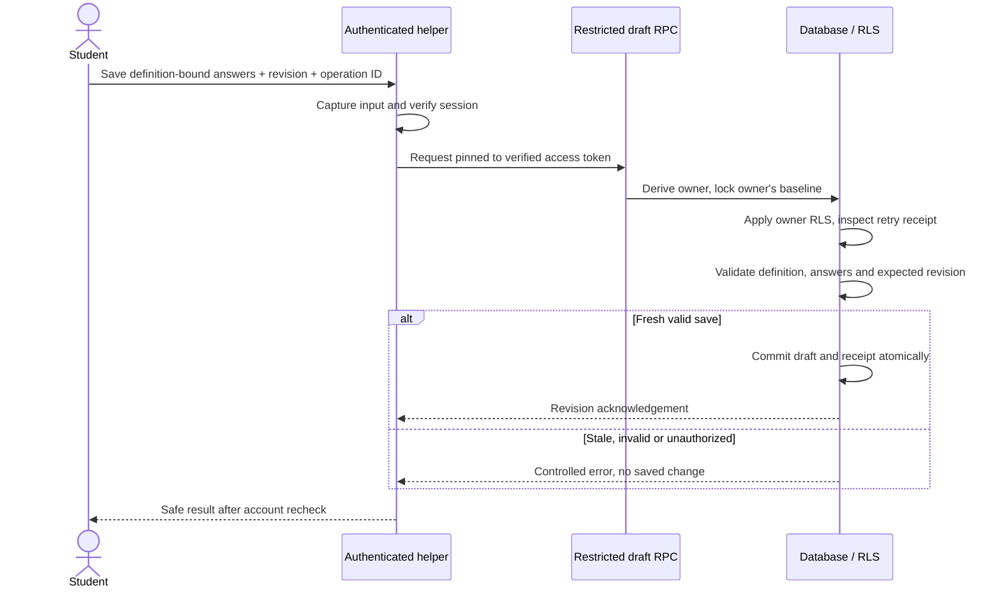
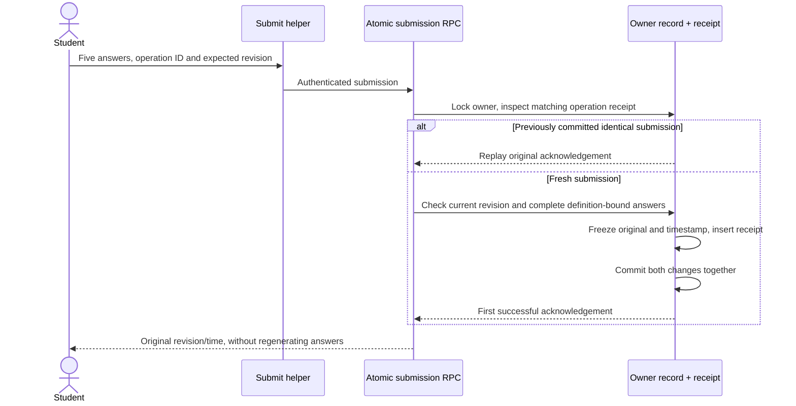
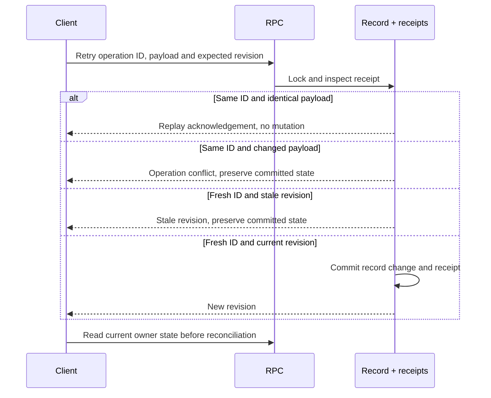
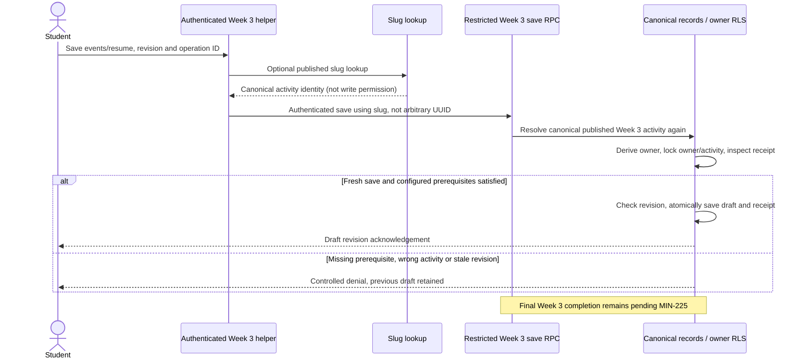

# MIN-262 — Authorization, persistence and recovery

**FDD review draft · evidence checked 29 October 2026.** The four sections below
provide approximately four manuscript pages of substantive FDD material before
references, with final pagination dependent on the team's layout and figure
size. No four-page rendered artifact or production deployment is asserted.

| Evidence tier                            | Scope and status                                                                                                                                                              |
| ---------------------------------------- | ----------------------------------------------------------------------------------------------------------------------------------------------------------------------------- |
| Accepted repository baseline             | Main at `e89819c`: owner RLS, Week 1/2 progress and intention-submission persistence                                                                                          |
| Implemented, unmerged                    | MIN-220 in [PR #55](https://github.com/Mindful-AI-SD/Mindful-AI/pull/55), commit `08ad566`: baseline definitions, originals and transactional receipts                        |
| Implemented partial foundation, unmerged | MIN-226 in [draft PR #56](https://github.com/Mindful-AI-SD/Mindful-AI/pull/56), commit `68952f1`: Week 3 drafts, lookup and prerequisite checks; final completion unavailable |
| Future/pending                           | Approved production definitions, Week 3 completion policy, attested comparison provenance, instructor summaries, shared-deployment recovery verification and Week 8 UI        |

## 1. Authenticated identity and the private-data boundary

MindfulAI associates private records with Supabase Auth identities. The existing
schema relates profiles and private progress/reflection records to `auth.users`.
Its row-level security (RLS) policies compare each private row's owner with
`auth.uid()`. Authentication identifies the caller; RLS determines which rows
that identity may access. A valid login therefore does not grant another
student's writing. Published curriculum follows a different policy and can be
readable without a login. These distinctions are present in the accepted schema
[S1].

An arbitrary client `user_id` is data, not proof of ownership. New private entry
points derive identity from authentication; RLS independently rejects forged
ownership. Signed-out private access is denied. Another authenticated student's
private reads return no rows and unauthorized mutations are denied [S1, S4–S6].

The existing Week 1 progress helper obtains the current user rather than
accepting an owner parameter, validates the Week 1 activity and filters reads by
both owner and activity. Its allowed patch fields exclude identity and
database-maintained update time. Existing Week 2 body-region data uses the same
private progress relation, rather than a new globally readable response table
[S2–S3]. JSON field updates replace whole values; they do not provide a general
conflict-free merge. Concurrent legacy edits to the same field remain
last-write-wins; legacy progress has no universal revision-based stale-write
guarantee. Whole-JSON-value replacement can therefore lose concurrent changes.

PR #55 strengthens the mutation boundary for new baseline data. Ordinary
students have owner-only SELECT but no direct INSERT, UPDATE or DELETE on
baseline records and receipts. Saves use restricted RPCs. Their
`baseline_writer` owner cannot log in, inherit privileges or bypass RLS and does
not own the tables. The role has no legacy private-table access or membership
granted to clients. An identity bridge returns only the invoking JWT's
`auth.uid()`; it accepts no owner argument and reads no student table. RLS
applies to both the old row selected for update and its proposed owner. Triggers
independently protect original submissions and definition metadata [S4].

PR #56 follows the same pattern with a separate `week_three_writer` role. It can
read only the owner-scoped completion columns needed from legacy progress, not
legacy writing or reflection answers. Publication, canonical identity and
configured prerequisites are checked inside the write operation. The mobile
helpers bind requests to a verified session token and reject account changes
before returning results. These mechanisms have been tested in local Supabase;
they are not claims about a deployed instructor or administrative service [S6].

Figure 1 separates draft validation from the database authorization boundary. A
route guard may explain eligibility, but a direct RPC must still pass RLS and
the write operation's checks. A mobile service-role credential would defeat this
boundary and is not part of the implementation.

## 2. Persistence lifecycle and immutable originals

The baseline storage added in PR #55 separates curriculum definitions from
private answers. A definition contains an immutable version and exactly five
ordered, unique question keys with prompts and answer bounds. A student's draft
pins its definition/version. Production wording remains an external MIN-219
input; synthetic definitions prove storage behavior without becoming approved
content. Changing the published definition cannot reinterpret an existing
original [S4].

Before submission, a student can save and reload a mutable draft. A successful
submission freezes the five original answers, their definition association and a
database-generated timestamp. Ordinary writes cannot return that record to draft
or create a replacement original under another operation ID. The original-only
retrieval method excludes mutable draft content and returns the pinned question
metadata alongside the exact saved submission. This is an implemented retrieval
interface for future Week 8 use, not an implemented Week 8 screen [S4–S5].

Figure 2 shows why submission does not use a durable intermediate claim.
Baseline submission is entirely a database transaction: no provider request
occurs between writing the record and writing its receipt. A failed transaction
cannot leave a success receipt without the corresponding original.

Week 3 storage in PR #56 is additive and does not overload legacy Week 1/2 rows.
It saves the checked-in Distraction Audit event shape (`id`, `at`, `label`),
canonical beat, private answers, paused/idle resume state and an optional report
cache. Whole-row revisions prevent stale snapshots from silently erasing newer
state. Event revisions change only when the event array changes; omitted patch
fields retain their values. A cached report keeps its original event snapshot
and revision when later events change, allowing the caller to recognize an
outdated report without discarding the last valid result [S6].

The report cache is not trusted evidence of which provider produced a result.
Attested source/mode history belongs to MIN-232. Timer state is also not proof
of participation. MIN-225 has not supplied Week 3's final completion predicate,
so new completion requests explicitly return an unavailable result. A trusted,
synthetically seeded terminal record was used only to test that completed state
cannot be downgraded. No production Week 3 completion rule is inferred [S6].

## 3. Idempotency, concurrency and recovery

The baseline and Week 3 draft operations distinguish a retry from an edit. Each
operation carries a client-generated UUID and expected revision. A transaction
lock serializes the relevant owner record; the database compares a canonical
request hash against the stored receipt. An identical request replays its
original acknowledgement. Reusing that UUID with changed input conflicts. A
fresh operation using an old revision also conflicts, preserving the winner's
data [S4, S6].

Figure 3 illustrates the reconciliation choices. A replay acknowledges a
previous revision; it does not write an old snapshot over a newer draft. After a
conflict, the client reloads and obtains an explicit decision before sending
reconciled data with a new operation ID.

Local tests exercised simultaneous saves from one revision and verified that
only one differing update succeeds. They also simulated transaction interruption
with an explicit rollback after record/receipt work and verified that the same
request can then succeed. Lost-response behavior was tested by retrying an
already committed request. These are database rollback and retry tests, not a
Docker crash, host restart, backup restore or shared-deployment recovery
exercise [S5–S6].

Existing intention generation has a different recovery problem. Its current-main
ledger claims a request before the provider call, then finishes by atomically
persisting a valid result and progress. Identical completed submissions replay;
changed-input reuse conflicts, failures preserve prior intentions, and an older
completion cannot overwrite a newer successful result. However, interruption
after the claim can leave `processing` indefinitely. Automatic reclamation is
excluded because a second provider call could duplicate generation [S7].

The existing intention ledger also permits owner-scoped direct writes under its
current RLS/grants. Its normal authenticated endpoint flow is verified, but it
must not be described as having the newer baseline's RPC-only mutation boundary
or tamper-proof provider attestation. No unrelated hardening is introduced in
this documentation ticket [S7].

Publication recovery differs between the new services. Baseline receipt replay
is inspected before publication checks, so a committed retry can succeed after
its definition is unpublished. Week 3 saves resolve a published target before
receipt lookup, so withdrawal prevents that replay. Both services preserve owner
retrieval of already-saved data. Week 3's fresh prerequisite checks use explicit
configured prior activities, never any completed Week 2 row. They use existing
owner-editable completion flags and transaction MVCC snapshots; independent
learning attestation and serializable coordination with legacy edits are not
claimed [S4, S6].

The available recovery evidence has deliberately bounded meanings:

| Recovery category             | Verified evidence or remaining gap                                                                     |
| ----------------------------- | ------------------------------------------------------------------------------------------------------ |
| Application/request retry     | Local rollback and committed-request replay; unchanged UUID/payload retries safely                     |
| Reload/resume                 | Owner retrieval restores committed draft, original or saved paused/idle Week 3 state                   |
| Migration compatibility       | Synthetic existing Week 1/2 fields retained; no claim of exhaustive historical production-data testing |
| Shared-deployment recovery    | Pending MIN-238; local tests do not establish deployed migration order or service restart recovery     |
| Backup/host-crash restoration | Not exercised; no verified disaster-recovery or backup-restore claim                                   |

## 4. Retrieval, access matrix and remaining evidence

Owner-only original retrieval accepts no client owner selector. Before
submission it returns no original and no original definition, rather than
presenting a draft as final. Definition withdrawal does not erase the pinned
original, and future comparison need not rewrite it [S4–S5].

Figure 4 shows the implemented Week 3 write boundary in unmerged PR #56. The
helper's earlier lookup does not grant permission to save: the database resolves
the slug again, fixes the expected week/kind, derives ownership and checks
explicit prior-week configuration. Manual REST mutation has no grant; direct RPC
calls must pass the same checks. A synthetic successful draft save proves this
boundary, not a production completion predicate [S6].

The matrix describes application boundaries. “Other student” means access to the
identified owner's data, not access to that caller's own separate record. A
future instructor has no implemented elevated entitlement. Trusted service-role
or database-administrator credentials can bypass ordinary client boundaries and
must remain server-side; that capability is not a student-facing API.

| Data category                          | Anonymous                                   | Authenticated owner                                   | Different student                                          | Future instructor                                        | Trusted server/service context                          |
| -------------------------------------- | ------------------------------------------- | ----------------------------------------------------- | ---------------------------------------------------------- | -------------------------------------------------------- | ------------------------------------------------------- |
| Published baseline definition (PR #55) | Denied: publication is not anonymous access | Read published or own pinned definition               | Read published; no other owner's private definition access | Proposed; no elevated role implemented                   | Trusted provisioning; immutable metadata versioning     |
| Own baseline draft (PR #55)            | Denied                                      | Read; restricted RPC writes                           | Denied                                                     | Proposed; no elevated role implemented                   | Privileged capability; not client-facing                |
| Own baseline original (PR #55)         | Denied                                      | Read; ordinary mutation denied                        | Denied                                                     | Proposed; no private-answer entitlement                  | Privileged maintenance outside normal client flow       |
| Another student's baseline             | Denied                                      | Denied for another owner's record                     | Denied                                                     | Proposed; no private-answer entitlement                  | Privileged capability, not a student RPC                |
| Own Week 1/2 progress (main)           | Denied                                      | Owner read/write under existing policies              | Denied                                                     | Proposed; no elevated role implemented                   | Privileged capability; not client-facing                |
| Another student's Week 1/2 progress    | Denied                                      | Denied                                                | Denied                                                     | Completion-only projection proposed, not raw progress    | Privileged capability, not a roster API                 |
| Own Week 3 draft/events (PR #56)       | Denied                                      | Read; RPC writes require prerequisites                | Denied                                                     | Proposed; no elevated role implemented                   | Trusted configuration; privileged capability            |
| Another student's Week 3 data          | Denied                                      | Denied                                                | Denied                                                     | No private event/answer entitlement proposed             | Privileged capability, not a student RPC                |
| Private reflection/writing (main)      | Denied                                      | Owner read/write under table policies                 | Denied                                                     | Excluded from proposed summaries                         | Privileged capability; not a roster payload             |
| Alias/configuration (PR #56)           | Denied                                      | Published alias SELECT only; no module administration | Same published alias SELECT; no mutation                   | No administration entitlement implemented                | Trusted provisioning only                               |
| Course completion summary              | No instructor API implemented               | No instructor API implemented                         | No instructor API implemented                              | Proposed membership/roster-scoped, completion-only query | Future bounded query; no client service-role credential |

Baseline originals are private even if a future instructor is authorized to see
completion counts. A safe instructor design would require membership, roster
scoping and completion-only projections; those policies are not implemented by
these PRs. Raw baseline answers, writing, intentions, event labels, answers,
cached reports and resume data must not become a roster payload by convenience
[S1, S6].

The current evidence supports separate review of this FDD material, not a claim
that Sprint 3 is deployed. Remaining gates are production definition approval
(MIN-219), production prerequisite configuration and final completion policy
(MIN-225), actual provider/non-AI contracts before provenance work, later
instructor access verification, and reproducible shared-deployment
migration/recovery tests (MIN-238/MIN-244). Backups, service restarts and
production failover remain outside the evidence available here.

### Local verification record

| Suite                                                                      | Recorded result                         |
| -------------------------------------------------------------------------- | --------------------------------------- |
| Baseline Auth/REST/RPC/RLS and recovery                                    | 24 tests passed, including parent       |
| Week 3 Auth/RPC/RLS and recovery                                           | 21 tests passed, including parent       |
| Activity lookup HTTP/RLS                                                   | 9 tests passed, including parent        |
| Existing progress / intention integration                                  | 8 / 9 tests passed                      |
| Mobile/service Node regression                                             | 171 tests passed                        |
| Shared backend / mindfulness / AI activity                                 | 350 tests / 33 cases / 119 cases passed |
| Scoped TypeScript, SQL lint, lint, formatting, whitespace, client security | Passed                                  |

Full frontend TypeScript still reports the seven previously reproduced baseline
CSS/media dependency diagnostics. No unrelated fix or test weakening is
included. These totals identify the exercised local suites, not new
shared-deployment coverage. The baseline integration suite verifies owner
isolation and legacy Week 1/2 fields; the Week 3 suite additionally verifies
that its writes leave synthetic legacy snapshots unchanged.

### Requirements traceability

[Jira MIN-262](https://mindfulnessai.atlassian.net/browse/MIN-262) requires four
additional FDD pages, persistence sequences and a role/data-access matrix based
on actual tests. This draft covers presently verified evidence; exact manuscript
pagination and later verification evidence remain review items.
[MIN-214](https://mindfulnessai.atlassian.net/browse/MIN-214) defines the
storage contract, [MIN-220](https://mindfulnessai.atlassian.net/browse/MIN-220)
supplies baseline implementation evidence, and
[MIN-226](https://mindfulnessai.atlassian.net/browse/MIN-226) supplies the
locally verified Week 3 foundation.
[MIN-225](https://mindfulnessai.atlassian.net/browse/MIN-225) remains the
approved completion-policy dependency;
[MIN-238](https://mindfulnessai.atlassian.net/browse/MIN-238) remains the
shared-deployment migration/recovery verification gate. Backup restoration and
host-crash recovery have not been exercised. The current instructor route
injects synthetic status-only fixtures and performs no roster database read. Its
preview does not constitute production authorization or evidence of an
implemented instructor role [S8].

### Source register

The links pin implementation versions so later branch changes do not silently
change the evidence behind the text. PR #55/#56 remain unmerged at this review.

- **S1:**
  [Main schema, Auth relationships and RLS](https://github.com/Mindful-AI-SD/Mindful-AI/blob/e89819cef332306a59b14028c3b9c0761c4e98bd/supabase/migrations/20260918014132_initial_schema.sql).
- **S2:**
  [Main progress helper](https://github.com/Mindful-AI-SD/Mindful-AI/blob/e89819cef332306a59b14028c3b9c0761c4e98bd/mobile/lib/progress-helpers.ts)
  and
  [Week 1 extension](https://github.com/Mindful-AI-SD/Mindful-AI/blob/e89819cef332306a59b14028c3b9c0761c4e98bd/supabase/migrations/20260925204659_extend_week_one_progress.sql).
- **S3:**
  [Main Week 2 persistence mapping](https://github.com/Mindful-AI-SD/Mindful-AI/blob/e89819cef332306a59b14028c3b9c0761c4e98bd/supabase/migrations/20261013000000_week_two_arrive.sql).
- **S4:**
  [PR #55 migration](https://github.com/Mindful-AI-SD/Mindful-AI/blob/08ad5664ed821f7060b912c0d154b1419a70a8cc/supabase/migrations/20261029000000_baseline_persistence.sql)
  and
  [typed service/helpers](https://github.com/Mindful-AI-SD/Mindful-AI/blob/08ad5664ed821f7060b912c0d154b1419a70a8cc/mobile/lib/baseline-helpers.ts).
- **S5:**
  [PR #55 local integration evidence](https://github.com/Mindful-AI-SD/Mindful-AI/blob/08ad5664ed821f7060b912c0d154b1419a70a8cc/mobile/tests/integration/baseline.test.cjs).
- **S6:**
  [PR #56 migration](https://github.com/Mindful-AI-SD/Mindful-AI/blob/68952f19d047e1ed1ac66b053f41fdcefa4fd2b3/supabase/migrations/20261029020000_week_three_persistence.sql),
  [lookup migration](https://github.com/Mindful-AI-SD/Mindful-AI/blob/68952f19d047e1ed1ac66b053f41fdcefa4fd2b3/supabase/migrations/20261029010000_activity_aliases.sql),
  [integration tests](https://github.com/Mindful-AI-SD/Mindful-AI/blob/68952f19d047e1ed1ac66b053f41fdcefa4fd2b3/mobile/tests/integration/week-three.test.cjs)
  and
  [contract/boundaries](https://github.com/Mindful-AI-SD/Mindful-AI/blob/68952f19d047e1ed1ac66b053f41fdcefa4fd2b3/docs/activity-lookup-foundation.md).
- **S7:**
  [Main intention-submission migration](https://github.com/Mindful-AI-SD/Mindful-AI/blob/e89819cef332306a59b14028c3b9c0761c4e98bd/supabase/migrations/20261001000000_intention_submissions.sql)
  and
  [integration tests](https://github.com/Mindful-AI-SD/Mindful-AI/blob/e89819cef332306a59b14028c3b9c0761c4e98bd/mobile/tests/integration/intention-persistence.test.cjs).

- **S8:**
  [Current-main instructor fixture model](https://github.com/Mindful-AI-SD/Mindful-AI/blob/e89819cef332306a59b14028c3b9c0761c4e98bd/mobile/lib/instructor-progress.ts)
  and
  [fixture-injected preview route](https://github.com/Mindful-AI-SD/Mindful-AI/blob/e89819cef332306a59b14028c3b9c0761c4e98bd/mobile/src/app/instructor.tsx).
