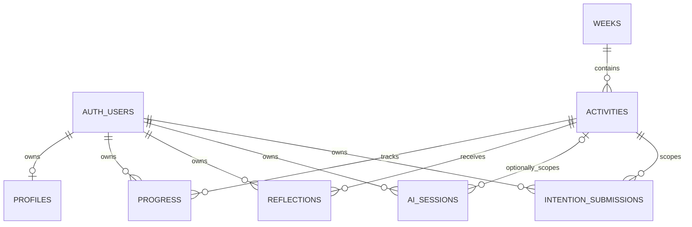

# Backend design baseline — MIN-250

Revision: 2026-10-28. Scope: approximately two manuscript pages, excluding
sources. This is an FDD replacement draft for PDD Section 5, not a
deployed-system report. The reviewed implementation is main commit
`7554e6fed509620cddea9f70a266c99b84d398c7`. Proposed Sprint 3 behavior is
identified separately. Pagination is determined when the team assembles the FDD.

## Architecture and accepted implementation

Mindful AI separates the student interface, authenticated server operations, and
private database state. The Expo application uses a public Supabase connection
and the signed-in session. PostgreSQL stores published curriculum and
student-owned records; row-level security (RLS) applies authorization
independently of screen navigation. Supabase Edge Functions validate
authenticated AI requests and keep provider configuration outside the mobile
bundle. This organization preserves the architecture described in PDD Section 5
while distinguishing implemented storage from the additional baseline and Week 3
services scheduled for Sprint 3. [1–3]

Published curriculum consists of weeks and ordered activities. A week has a
unique ordinal from one through eight; each activity has a UUID and a parent
week. Publication policies require both the activity and its parent week to be
published. The current curriculum loader supports Weeks 1 and 2. Application
content uses the canonical Arrive, Practice, Explore, Notice order, but this
domain contract does not create four persistent database records. Legacy steps
remain readable without rewriting saved progress. Practice configuration and
local interruption recovery are separate from authoritative completion; restored
timer or media position is not evidence that a module has been completed. [2, 3]

**Figure 1. Current relational structure.** The figure contains only relations
present in checked-in migrations. Progress joins an authenticated owner to an
activity; the intention ledger permits multiple generation submissions for that
owner and activity. AI-session activity association is nullable. There is no
baseline, Week 3 log, generic beat-progress, course, enrollment, or instructor
membership relation on inspected main. Consequently, those concepts must not be
added to the implemented ERD merely because a historical branch or UI preview
contains a related design. [3]

The principal resume record is `progress`, whose composite primary key is
`(user_id, activity_id)`. Status and completion timestamp are constrained
together; steps must be nonblank, intentions must be a JSON array, and
reflection answers must be a JSON object. The database does not constrain all
legacy step names or require completion time to follow start time. These limits
correct an overly broad reading of PDD Table 8: ownership restrictions in a
helper API are not identical to column restrictions on every direct REST
request. Existing owner RLS prevents cross-account access, but is not a global
immutable-completion or prerequisite mechanism. [1, 3]

## Persistence, ownership and failure preservation

Week 1 stores writing, intentions and reflection answers in the progress record.
Week 2 uses the same relation for body-region selection, sensation vocabulary,
reflections and its saved step. These values are private learner data, including
apparently structured body-map values. Week-specific save paths preserve
unrelated answers and use saved-step/update-time predicates for
conflict-sensitive changes. The generic progress helper instead performs partial
upserts: omitted columns are preserved, supplied JSON values replace the whole
value, and concurrent writes to the same field remain last-write-wins. The
composite key prevents duplicate rows; it does not prevent every lost update.
Existing completion and resume behavior must remain intact when additive Sprint
3 relations are introduced. [3]

The Week 1 `mindfulness-response` compatibility endpoint uses a durable
intention submission ledger. A client submission UUID and normalized-input hash
identify a request under its authenticated owner. Identical completed retries
replay the saved result, changed input conflicts, and successful finalization
atomically persists intentions and the response. Serialization prevents an older
success from replacing a newer successful generation. Provider failures preserve
the last valid intentions. A process interrupted after claiming a request can
leave a pending entry; automatic reclamation is deliberately absent because it
could duplicate a still-running provider call. This is a known recovery
limitation, not a verified restart-repair service. [3]

The unified `ai-activity` endpoint is different: it validates and returns
results without storing progress. Its Week 3 Distraction Audit accepts bounded,
uniquely identified timestamped events and validates category assignments;
arithmetic is computed on the server. The presence of this provider contract
does not establish Week 3 save/resume or completion services. The selected
working provider is the mock. The `future` provider is an unavailable stub, not
a live Claude adapter or a true prewritten non-AI learning path. Sprint 3
explicitly assigns those provider implementations to a separate owner. [3, 4]

Private tables use owner policies based on authenticated identity. Public-client
helpers and Edge Function authentication reinforce this boundary; provider and
service-role secrets do not belong in the Expo client. Profiles contain no
instructor role, and the current instructor completion screen uses synthetic
roster data. Neither that preview nor a user-editable metadata field authorizes
cross-student reads. Any future instructor data path must provide verified
roster membership and a completion-only projection while withholding writing,
intentions, reflections, body-map data and raw resume JSON. [1, 3]

## Required design evolution and evidence limits

MIN-214 proposes a separate owner-scoped baseline with a mutable draft, an
immutable submitted original, versioned question definitions, revision-based
conflict handling and transactional retry receipts. A later owner-only read
would return that original for Week 8 comparison without rebuilding it from
legacy writing or current question copy. However, the retrieved PDD and Sprint 3
plan establish the five-answer requirement without supplying the exact five
question texts. MIN-219 must supply the approved definition before synthetic
question slots become a production contract. No baseline migration or retrieval
implementation is claimed here. [4, 5]

MIN-226 would add canonical slug resolution and Week 3 storage with prerequisite
checks below the navigation layer. A readable slug currently is not a database
activity UUID, and the schema has no alias registry. MIN-225 must establish
exact Week 3 completion conditions; unresolved Week 2 requirements remain
unchanged. MIN-232 would preserve the actual mode and content/result versions
used for each result, rather than relabelling historical output after
configuration changes. These proposals require separate migrations, service
tests and privacy review; none is represented as an existing table or tested
provider configuration. [3–5]

The ERD revision for MIN-256 should retain current keys, nullable associations,
privacy classes and lifecycle constraints, then show finalized baseline/receipt
and activity-alias/Week 3 relations only after their migrations exist. Proposed
entities should occupy a separately labelled future diagram until then. MIN-262
requires actual authorization, concurrency and recovery evidence from the new
services. Future Week 8 screens and live instructor access remain separate
design paths, not consequences of adding baseline retrieval. [4, 5]

Existing repository verification records describe local database and
mock-provider checks plus browser walkthroughs with simulated Auth/progress
boundaries. Those records are historical evidence, not new deployment results.
On this review date, Docker is unavailable in the active WSL distro; no
migration, RLS suite or shared test deployment has been exercised. This FDD
revision is grounded in inspected source and PDD material, and makes no new
live-provider, native-device or recovery certification claim. [3, 6]

## Sources and traceability

1. [Submitted PDD, Section 5 and Table 8](https://drive.google.com/file/d/1GRKV9bP8LfiF-MsQjJTYUN_VcHJMxgVC/view),
   reviewed 2026-10-28; original backend contribution also reviewed at
   [Lucas's PDD contribution](https://docs.google.com/document/d/1bqO4q32T8sFHUClfNhCj5t30S3dLX9Tw/edit).
2. [Four-beat contract on inspected main](https://github.com/Mindful-AI-SD/Mindful-AI/blob/7554e6fed509620cddea9f70a266c99b84d398c7/mobile/lib/four-beat-curriculum.ts)
   and
   [legacy mapping](https://github.com/Mindful-AI-SD/Mindful-AI/blob/7554e6fed509620cddea9f70a266c99b84d398c7/mobile/lib/week-one-module.ts).
3. [Source snapshot](https://github.com/Mindful-AI-SD/Mindful-AI/tree/7554e6fed509620cddea9f70a266c99b84d398c7):
   all six `supabase/migrations/` files; `mobile/lib/progress-helpers.ts`,
   `week-one.ts`, `week-two.ts`, `curriculum.ts`, `supabase.ts`,
   `instructor-progress.ts`; `supabase/functions/mindfulness-response/`,
   `ai-activity/index.ts`, `_shared/providers/providerSelector.ts`,
   `futureProviderAdapter.ts`; `supabase/schema/distractionAuditSchema.ts`.
4. [Sprint 3 action plan](https://drive.google.com/file/d/1sjlq2GoZenFSeAkl5juxXMzLcvit1XON/view),
   including responsibilities and dependency order.
5. Jira requirements reviewed 2026-10-28:
   [MIN-214](https://mindfulnessai.atlassian.net/browse/MIN-214),
   [MIN-219](https://mindfulnessai.atlassian.net/browse/MIN-219),
   [MIN-220](https://mindfulnessai.atlassian.net/browse/MIN-220),
   [MIN-225](https://mindfulnessai.atlassian.net/browse/MIN-225),
   [MIN-226](https://mindfulnessai.atlassian.net/browse/MIN-226),
   [MIN-232](https://mindfulnessai.atlassian.net/browse/MIN-232),
   [MIN-250](https://mindfulnessai.atlassian.net/browse/MIN-250).
6. [Recorded browser evidence](https://github.com/Mindful-AI-SD/Mindful-AI/blob/7554e6fed509620cddea9f70a266c99b84d398c7/mobile/verification/student-instructor-walkthroughs.md);
   [existing progress integration suite](https://github.com/Mindful-AI-SD/Mindful-AI/blob/7554e6fed509620cddea9f70a266c99b84d398c7/mobile/tests/integration/progress-helpers.test.cjs).
