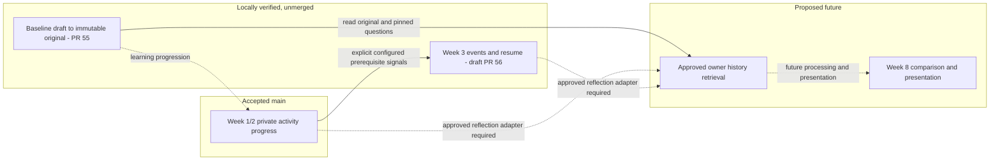
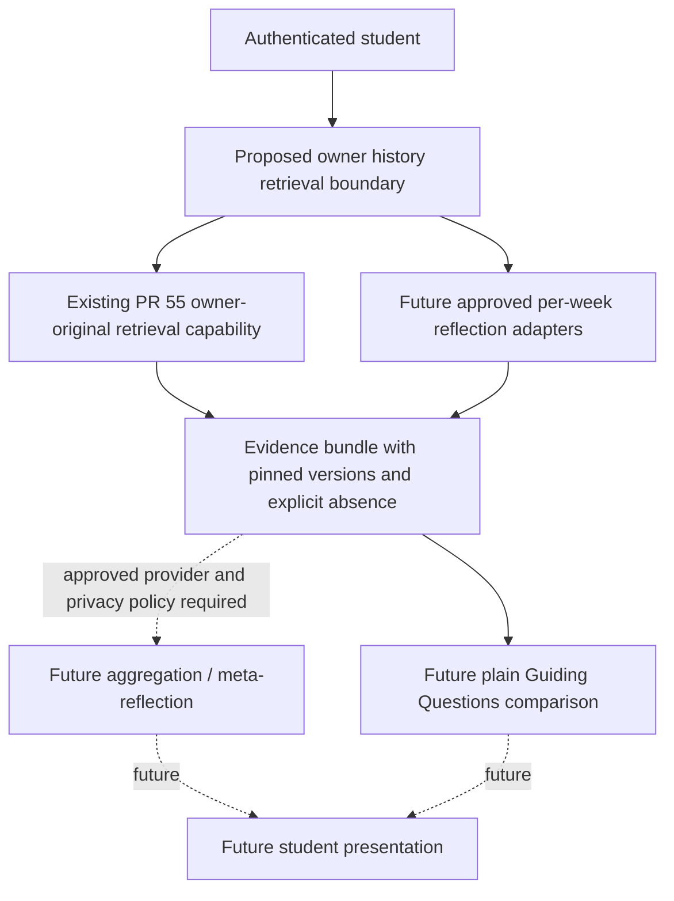
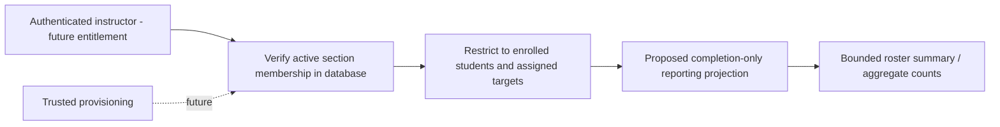

# MIN-268 — Cross-week and instructor data design

**FDD draft · 29 October 2026.** This contribution supplies approximately four
additional manuscript pages before references; final pagination depends on FDD
assembly and figure sizing. It distinguishes accepted repository behavior,
locally verified unmerged implementation, and future design. No deployment, Week
8 screen, instructor authorization service or new migration is claimed.

## 1. Cross-week identity and historical meaning

The accepted main schema links each activity UUID to one curriculum week and
each private progress row to an authenticated owner and canonical activity. A
unique owner/activity key prevents duplicate legacy progress records. Week 1 and
Week 2 use that existing relation for their private state; a completed activity
is not four independently persisted beats. The canonical Arrive, Practice,
Explore and Notice contract is a content/navigation abstraction, not evidence
that generic per-beat persistence exists on main [S1–S2].

The cross-week design therefore avoids a single growing student record
containing every week's answers. Curriculum identity remains shared metadata,
while each private storage domain owns its lifecycle: legacy activity progress,
the original baseline, Week 3 event/progress state, and any future comparison
attempt. Data is joined by authenticated identity and explicit canonical
references when a bounded service actually needs it. It is not copied into an
instructor-facing student profile or a global raw-answer report [S1, S3–S5].

Figure 1 describes learning progression and data dependencies, not implemented
route enforcement for every week. Existing Week 1/2 values remain intact; future
Week 8 reads reference historical evidence rather than moving or overwriting it.
The baseline has one record per owner, not an activity UUID or course-specific
attempt. Its relationship to the curriculum is its pinned baseline definition.

**Figure 1. Cross-week student data path by implementation tier.** Solid links
from the baseline represent its implemented original-retrieval capability; the
combined history service and its links to later processing remain proposed. No
aggregate Week 8 history API is implied by the presence of stored progress.

## 2. Baseline and Week 3 lifecycle boundaries

MIN-220 is implemented in unmerged PR #55, informed by the MIN-214 contract.
Versioned definitions contain exactly five ordered, unique question keys,
question text and answer bounds. A mutable owner draft pins its
definition/version and uses a revision to reject stale saves. Submission freezes
all five original answers and the server timestamp. Definition question metadata
is immutable; publication can change without rewriting the original [S3–S4].

The original is logically separate from mutable later responses. Physically, PR
#55 transitions the same `baseline_records` owner row from draft to submitted;
it does **not** introduce a second original-answer table. After submission,
ordinary client writes cannot change that record, return it to draft, or replace
it with another original. Any future Week 8 current answers must live in a
separate, explicitly designed response/attempt store. This preserves the
comparison anchor instead of silently comparing two versions of the latest
mutable answer. Production five-question metadata remains owned by MIN-219,
currently To Do; synthetic test definitions are not approved sponsor content
[S3–S4, J1].

An operation UUID, canonical request hash and expected revision distinguish a
retry from a new edit. Record changes and retry receipts commit together under
an owner transaction lock. Identical retries acknowledge the original successful
revision; changed payload using that ID conflicts. A second submission cannot
replace the original. Owner-only retrieval returns the original and its pinned
definition, or explicitly reports absence before submission. These behaviors
were verified with two authenticated accounts and rollback/concurrency tests
[S4].

Draft PR #56 adds immutable activity aliases and separate owner/activity Week 3
state. A write resolves its slug to a published Week 3 `ai_lab` activity inside
the transaction; a caller cannot substitute an arbitrary owner, activity UUID or
expected week. The backend then checks an enabled, trusted prerequisite mapping
and the authenticated owner's completed, timestamped records for each explicitly
configured earlier activity. Both prior weeks must be represented. Missing
configuration fails closed; any completed row in a week is insufficient [S5].

The private event snapshot retains the existing Distraction Audit shape: `id`,
`at` and `label`. Resume state records bounded elapsed/position values and an
idle/paused state without adding background time. Whole-row revisions protect
against stale updates; an event revision changes only with event data. Omitted
patch fields retain their values. Atomic receipts make identical saves
repeatable without duplicating records. Direct REST mutation is denied, and a
manual RPC must pass the same identity, publication, prerequisite and revision
checks [S5].

A categorized report cache includes its own input events/revision and source
label. A later event edit preserves that report as an older snapshot rather than
pretending that it describes the changed log. The cache is not attested provider
provenance and does not replace an approved weekly reflection. Completed records
remain immutable, but final Week 3 completion is explicitly unavailable pending
MIN-225. No production aliases, answer keys or prerequisite mappings are seeded.
Legacy completion signals remain owner-editable, so prerequisite checks are not
independent proof of participation [S5, J1].

Stable identifiers prevent accidental joins to another activity; they do not
freeze every editable title or content body. Baseline definitions preserve
actual historical question metadata. Week 3 pins a content-version label and
report input snapshot, but does not archive a complete immutable curriculum or
attest the source of every result. Future content/version registries must retain
meaningful historical metadata rather than reuse a version label for different
content. Legacy progress also remains last-write-wins for competing field
updates; its historical answers are not automatically immutable snapshots [S1,
S4–S6].

## 3. Proposed Week 8 evidence path

The checked-in curriculum test matrix maps the AIM-YA v5.0 draft and Four Beats
Weekly Map to an A8 Meta-Reflection: seven stored reflections, traceable themes,
and a side-by-side Guiding Questions comparison. The provider-contract document
specifies owner history compiled server-side, coverage of missing weeks and
quoted evidence. These are repository specification/design sources, not proof
that the original sponsor documents or final approval were inspected here. Their
historical implementation-status comments are not treated as current schema
inventory; current main already stores Week 2 progress [S1, S7].

The proposed path separates three responsibilities. First, authenticated owner
retrieval obtains the immutable original baseline through the PR #55 interface
and only the approved weekly reflection evidence. Second, a future bounded
aggregation/meta-reflection service may process that material under an approved
provider/privacy policy. Third, a future Week 8 presentation can show
comparison, coverage and tentative findings. None of the latter two services or
a combined history query is implemented by these PRs [S4, S7].

Figure 2 preserves that separation. Owner-only retrieval supplies stored
evidence, not a diagnosis or inferred replacement for a missing reflection. The
design does not expose a client-selected list of users or arbitrary private JSON
fields.

**Figure 2. Proposed Week 8 retrieval, processing and presentation.** The plain
baseline comparison is a data read, not a model call. Private owner retrieval
precedes any future processing, and lack of an approved processing mode must not
prevent recovery of the already-stored original.

The reflection adapters require an approved mapping from curriculum activity and
content version to a particular saved reflection, not a scan of all text fields.
Current Week 1/2 private JSON, the schema's generic `reflections` table and Week
3 event labels are not interchangeable sources. Missing entries must remain
missing; a draft must not silently become a submitted historical reflection. The
response should identify included/missing weeks, stored evidence identity and
version, without reconstructing absent answers through AI. Any quoted finding
must trace to retrieved owner evidence, with interpretation distinguished from
observation. The acceptable sparse-history threshold and approved reflection
fields remain unresolved specification/product inputs [S1, S7].

## 4. Proposed instructor completion path

Current main's instructor preview injects synthetic status-only fixtures. It has
no production roster query and establishes no instructor authority. The schema
has no course/section, enrollment or instructor-membership relation, and profile
metadata or a display name cannot grant access to other students [S1, S8]. The
older local MIN-127 draft was consulted only as historical design input; its
obsolete MIN-110 assumptions are not imported into this design.

A tracking discrepancy remains explicit: Jira marks the historical Sprint 2
MIN-132 and MIN-144 tickets Done, but the inspected main migrations contain no
production instructor-membership, enrollment or reporting query. Their status
alone cannot establish production authorization or two-student/instructor
database verification. Accepted scope and supporting evidence should be
reconciled with the team; this design does not reopen those closed tickets or
overwrite accepted Sprint 2 work [S1, S8, J2].

The smallest future model uses a course/section authorization scope, explicit
instructor membership, student enrollment and assigned completion targets. A
single section may initially hold course/section labels; a separate course
parent is a product choice. Trusted provisioning, not student signup metadata,
establishes membership. A proposed query accepts a section identifier as a
filter, derives caller identity from authentication and verifies active
membership inside the same database query/snapshot as roster scoping. Unknown
and unauthorized sections should produce the same controlled denial, not an
existence oracle.

Figure 3 deliberately excludes private answer tables from the instructor path. A
future completion projection contains only permitted status facts, and its own
access boundary rechecks membership and enrollment. No client-side role check or
privileged mobile credential can substitute for database authorization.

**Figure 3. Proposed instructor summary boundary.** The reporting projection is
a future, deliberately limited completion dataset. The diagram grants no direct
traversal into baseline answers, writing, reflection bodies, intentions,
body-map answers, event labels, raw JSON, resume state or private AI
input/output.

Ordinary security-invoker SELECT on current progress cannot produce this report:
existing student RLS correctly hides other owners and the row contains private
fields. Broadening student policies or adding an instructor SELECT policy to the
whole private table would undermine that boundary. The recommended future
boundary is a separate completion-only relation/projection with section-scoped
RLS and an invoker query. It would need trustworthy synchronization with source
completion, including revocation/deletion semantics; it does not yet exist.

If direct source querying is selected instead, a carefully restricted read RPC
could run as a separate NOLOGIN/NOBYPASSRLS reporting role, with column-level
SELECT only on status/identity/timestamps and role-specific roster-constrained
RLS. That role must not own source tables or be granted to clients. This is a
proposed alternative requiring security tests, not an implemented
security-definer guarantee. Either design must scope every join and aggregate
denominator to the same authorized section and explicit assignment targets;
source status is app-reported completion, not an independently verified grade
[S1, S6, J2].

The minimum proposed output is an approved roster/student identifier, curriculum
week/activity reference, status, optional completion time and bounded aggregate
counts/percentages. Private text is excluded even if the reporting query could
technically access it. Missing progress should be distinguishable from
not-started only as approved by the summary contract; percentages require a
defined roster and assignment denominator. Activity completion must not be
multiplied into four beat completions by looking at a legacy current-step
string.

Open decisions include who provisions/revokes membership, what student
identifier may be disclosed, which targets count toward a section, and whether
historical completion transfers when enrollment changes. Current progress is
global per owner/activity, not per-section attempts. Truly separate course
attempts would require a new approved storage design. Retention, deletion,
history approval and external-provider handling likewise require explicit
decisions. No instructor portal, reporting migration or private-data grant is
added by this document.

### Implemented versus proposed

| Component                                 | Evidence/status                           | Outstanding boundary                                                                                                 |
| ----------------------------------------- | ----------------------------------------- | -------------------------------------------------------------------------------------------------------------------- |
| Legacy Week 1/2 progress                  | Implemented on main                       | Owner-private, mutable field saves; not per-section or generic beat history                                          |
| Baseline persistence and original read    | Implemented, unmerged PR #55              | MIN-219 production definitions pending; no Week 8 UI                                                                 |
| Activity aliases                          | Implemented, unmerged draft PR #56        | Production aliases/mappings not seeded                                                                               |
| Week 3 event/draft/resume/cache state     | Implemented, unmerged draft PR #56        | MIN-225 final completion policy pending                                                                              |
| Completion prerequisites                  | Configurable backend checks in PR #56     | Production mappings need approval; stored legacy signal is not attestation                                           |
| Instructor membership and enrollment      | Proposed, absent from main                | Trusted provisioning, section boundary and identifier decisions                                                      |
| Instructor completion query               | Proposed, absent from main                | Historical MIN-132/MIN-144 are Done in Jira; production query/verification evidence is not present in inspected main |
| Owner baseline-only retrieval for Week 8  | Implemented capability in unmerged PR #55 | Future Week 8 consumer still required                                                                                |
| Combined Week 8 history retrieval         | Proposed                                  | Approved per-week evidence adapters, missing-data policy and history coverage                                        |
| Week 8 aggregation/meta-reflection and UI | Proposed, not implemented                 | Approved provider/content/privacy contracts; no invented comparison behavior                                         |
| Attested comparison provenance            | Pending MIN-232                           | MIN-223/MIN-231/MIN-235 production paths unavailable                                                                 |

This separation extends the MIN-256 ERD/data dictionary and MIN-262
authorization analysis without rewriting their open PRs. The MIN-256 document
predates the implementation PRs and correctly labels those additions proposed at
its own snapshot; this document uses the newer locally verified, unmerged tier.
Shared deployment and recovery remain future MIN-238 evidence. Neither a
repository merge nor a draft figure establishes deployed behavior [S3, S6,
J1–J2].

## Source register

Pinned links preserve the inspected snapshot rather than silently following
later branch changes. MIN-214, MIN-256 and MIN-262 remain separate review
contributions. No old MIN-127 draft is an authoritative source for current
implementation.

- **S1 — Main schema and persistence:**
  [schema/RLS](https://github.com/Mindful-AI-SD/Mindful-AI/blob/e89819cef332306a59b14028c3b9c0761c4e98bd/supabase/migrations/20260918014132_initial_schema.sql),
  [Week 1 extension](https://github.com/Mindful-AI-SD/Mindful-AI/blob/e89819cef332306a59b14028c3b9c0761c4e98bd/supabase/migrations/20260925204659_extend_week_one_progress.sql),
  [Week 2 mapping](https://github.com/Mindful-AI-SD/Mindful-AI/blob/e89819cef332306a59b14028c3b9c0761c4e98bd/supabase/migrations/20261013000000_week_two_arrive.sql).
- **S2 — Current content contract:**
  [four-beat model](https://github.com/Mindful-AI-SD/Mindful-AI/blob/e89819cef332306a59b14028c3b9c0761c4e98bd/mobile/lib/four-beat-curriculum.ts).
- **S3 — Design inputs under review, still unmerged:**
  [MIN-214 contract](https://github.com/Mindful-AI-SD/Mindful-AI/blob/5f4cf124f2dabbc6380cfce37b0a71edefa4d618/docs/sprint-3/min-214-storage-contracts.md),
  [MIN-256 ERD](https://github.com/Mindful-AI-SD/Mindful-AI/blob/e0bd19989eea1efbdc324d8e3613f1416e05dc5f/docs/fdd/erd-and-data-dictionary.md),
  [field dictionary](https://github.com/Mindful-AI-SD/Mindful-AI/blob/e0bd19989eea1efbdc324d8e3613f1416e05dc5f/docs/fdd/data-dictionary.csv).
- **S4 — MIN-220, locally verified and unmerged:**
  [PR #55](https://github.com/Mindful-AI-SD/Mindful-AI/pull/55),
  [migration](https://github.com/Mindful-AI-SD/Mindful-AI/blob/08ad5664ed821f7060b912c0d154b1419a70a8cc/supabase/migrations/20261029000000_baseline_persistence.sql),
  [helpers](https://github.com/Mindful-AI-SD/Mindful-AI/blob/08ad5664ed821f7060b912c0d154b1419a70a8cc/mobile/lib/baseline-helpers.ts),
  [integration evidence](https://github.com/Mindful-AI-SD/Mindful-AI/blob/08ad5664ed821f7060b912c0d154b1419a70a8cc/mobile/tests/integration/baseline.test.cjs).
- **S5 — MIN-226, locally verified and unmerged:**
  [draft PR #56](https://github.com/Mindful-AI-SD/Mindful-AI/pull/56),
  [migration](https://github.com/Mindful-AI-SD/Mindful-AI/blob/68952f19d047e1ed1ac66b053f41fdcefa4fd2b3/supabase/migrations/20261029020000_week_three_persistence.sql),
  [lookup](https://github.com/Mindful-AI-SD/Mindful-AI/blob/68952f19d047e1ed1ac66b053f41fdcefa4fd2b3/supabase/migrations/20261029010000_activity_aliases.sql),
  [tests](https://github.com/Mindful-AI-SD/Mindful-AI/blob/68952f19d047e1ed1ac66b053f41fdcefa4fd2b3/mobile/tests/integration/week-three.test.cjs),
  [boundaries](https://github.com/Mindful-AI-SD/Mindful-AI/blob/68952f19d047e1ed1ac66b053f41fdcefa4fd2b3/docs/activity-lookup-foundation.md).
- **S6 — MIN-262 authorization evidence:**
  [draft PR #57](https://github.com/Mindful-AI-SD/Mindful-AI/pull/57),
  [authorization/recovery document](https://github.com/Mindful-AI-SD/Mindful-AI/blob/023c51ce56b06901af5fb08217788adac8fc5c42/docs/fdd/authorization-persistence-recovery.md).
- **S7 — Repository curriculum/spec mappings, not completed Week 8 services:**
  [A8 acceptance matrix](https://github.com/Mindful-AI-SD/Mindful-AI/blob/e89819cef332306a59b14028c3b9c0761c4e98bd/supabase/tests/fixtures/aiPolicyCurriculumTestMatrix.md),
  [future Meta-Reflection contract](https://github.com/Mindful-AI-SD/Mindful-AI/blob/e89819cef332306a59b14028c3b9c0761c4e98bd/supabase/functions/_shared/providers/activityContracts.md).
- **S8 — Instructor preview is synthetic:**
  [fixture model](https://github.com/Mindful-AI-SD/Mindful-AI/blob/e89819cef332306a59b14028c3b9c0761c4e98bd/mobile/lib/instructor-progress.ts),
  [preview route](https://github.com/Mindful-AI-SD/Mindful-AI/blob/e89819cef332306a59b14028c3b9c0761c4e98bd/mobile/src/app/instructor.tsx),
  [preview tests](https://github.com/Mindful-AI-SD/Mindful-AI/blob/e89819cef332306a59b14028c3b9c0761c4e98bd/mobile/__tests__/instructor-progress.test.js).
- **J1 — Current requirements/dependencies:**
  [MIN-268](https://mindfulnessai.atlassian.net/browse/MIN-268),
  [MIN-219](https://mindfulnessai.atlassian.net/browse/MIN-219),
  [MIN-225](https://mindfulnessai.atlassian.net/browse/MIN-225),
  [MIN-232](https://mindfulnessai.atlassian.net/browse/MIN-232).
- **J2 — Future authorization/operations:**
  [MIN-132](https://mindfulnessai.atlassian.net/browse/MIN-132),
  [MIN-144](https://mindfulnessai.atlassian.net/browse/MIN-144),
  [MIN-238](https://mindfulnessai.atlassian.net/browse/MIN-238).
