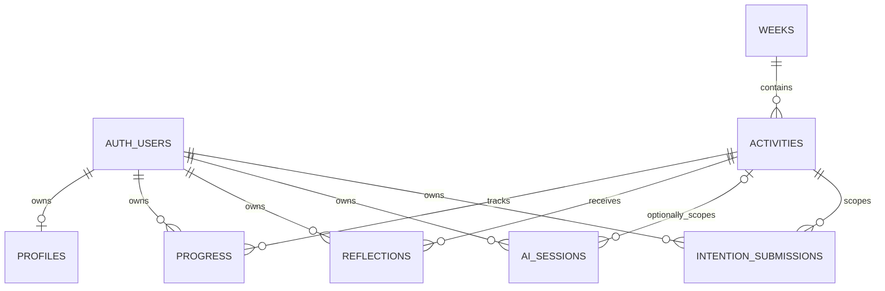
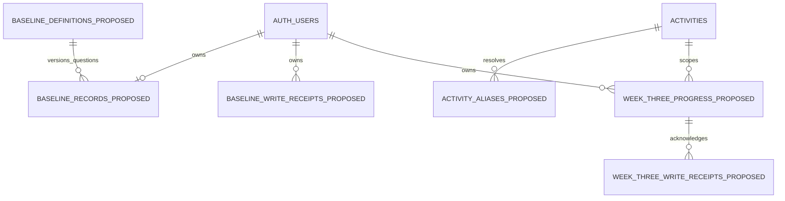

# ERD and data dictionary — MIN-256

Review date: 2026-10-28. This FDD contribution distinguishes the current
relational model from proposed Sprint 3 additions. It is intended to supply the
four-page design contribution together with the tabular field appendix; final
page count depends on the assembled FDD layout. No migration or database test is
performed by this document.

The implementation snapshot is `origin/main` commit
`7554e6fed509620cddea9f70a266c99b84d398c7`. The proposed snapshot is
[MIN-214 PR #53](https://github.com/Mindful-AI-SD/Mindful-AI/pull/53), contract
`sprint3-storage/v1`, commit `5409a1ca962f7967fda472c83c785b1155646a69`. A
proposed relation in this contribution is not evidence that it exists in a
local, test, or production database. All design claims remain subject to
migration review and execution when MIN-220 and MIN-226 are implemented. [1–3]

## 1. Current relational model

**Figure 1. Implemented relationships in checked-in migrations.** Supabase Auth
provides the owner identity, while curriculum identity comes from weeks and
activities. A user can own many activity records, but a composite key prevents
multiple progress rows for the same user and activity. A profile is optional at
the relational level even though the signup trigger creates one during ordinary
registration. Activities have one parent week. AI sessions may outlive an
activity delete because that association is nullable and uses SET NULL. The
other shown private activity foreign keys cascade on activity deletion. These
differences matter when planning retention and recovery. [1]

| Current relation        | Key and relationship                    | Lifecycle and privacy                                                        |
| ----------------------- | --------------------------------------- | ---------------------------------------------------------------------------- |
| `profiles`              | Auth UUID PK/FK                         | Mutable owner profile; no instructor-role column                             |
| `weeks`                 | Numeric identity PK; unique ordinal 1–8 | Published curriculum; trusted writes                                         |
| `activities`            | UUID PK; week FK; unique week/sequence  | Published only with published parent week                                    |
| `progress`              | Composite owner/activity PK             | Private Week 1/2 resume, writing, answers and completion                     |
| `reflections`           | UUID PK; unique owner/activity          | Private body and draft/submitted status; not the main current Week 1/2 store |
| `ai_sessions`           | UUID PK; nullable activity FK           | Private owner session counts/times; no prompt text column                    |
| `intention_submissions` | Composite owner/submission PK           | Private claim, replay or safe-failure state for Week 1 generation            |

Figure 1 deliberately excludes generic `beat_progress`: that migration exists
only on a historical branch, not current main. It also excludes baseline
answers, Week 3 logs, course membership and roster relations. The canonical
four-beat contract is an application abstraction, not four independent storage
records. Inserting a domain concept into an implemented ERD without its
migration would misstate both the data lifecycle and the security boundary. [1,
4]

## 2. Current field dictionary and interpretation

The accompanying [field dictionary](data-dictionary.csv) is a tabular appendix
with one row per field. Its columns are **status, entity, field, type,
key_or_constraint, ownership, lifecycle, privacy, relationship, and source**.
Implemented entries enumerate every column of the seven application tables, plus
only the referenced `auth.users.id` identity. The remainder of the Auth schema
is managed by Supabase and is not reconstructed from application FKs. Proposed
entries are labelled on every row, so a filtered/exported subset retains its
implementation status. [1, 2]

The `progress` checks enforce three statuses, a nonblank current step, top-level
JSON array/object shape and completion-time presence consistent with status.
They do not constrain every step to a WeekOneStep enum, validate every JSON
answer, or enforce completion time after start time. Generic progress upserts
preserve omitted columns but replace a supplied JSON value as a whole.
Week-specific transitions use current-step and update-time predicates for
optimistic conflict checks. Consequently, a unique progress key is evidence of
duplicate-row prevention, not proof of universal stale-write protection. [1, 5]

The distinction between helper and database restrictions is especially
important. The MIN-64 helper rejects owner/activity/update-time fields from
patches and resolves the signed-in account. Existing database grants still
permit an owner to perform the allowed table operations under RLS; they do not
create a global terminal-state protection for every completed legacy row. The
dictionary records that limitation rather than implying that the proposed
baseline immutability already applies to Week 1 and Week 2. No unrelated
hardening is introduced here.

The submission ledger similarly has different guarantees at different layers.
Its SQL CHECK relates processing/completed/failed state to response/failure
presence, while the finish RPC performs detailed intention validation and atomic
progress persistence. Identity sequences order finalization, but the sequence
column has no separately declared UNIQUE constraint. Existing ordinary grants
include owner insert/update, so the documented RPC lifecycle must not be
confused with a new table-wide immutable-original rule. Hashes and claim tokens
remain private metadata even though they are not raw reflection text. [1, 5]

Privacy classification follows the stored information rather than UI visibility.
Writing, intentions, body regions, sensation strings, reflection JSON, event
labels and resume state are student-private. Row keys, completion state and
times also remain owner-private under current RLS. A future instructor summary
may project a deliberately restricted subset only after real membership and
roster authorization exists. The present instructor screen renders synthetic
status-only fixtures; its type does not confer database access. [1, 4, 6]

## 3. Proposed Sprint 3 additions — not migrated

**Figure 2. Proposed additive relations from MIN-214.** Every suffixed entity is
future schema. Auth users and activities are the existing anchors. Definition
identity is composite: an identifier plus a version selects one immutable set of
exactly five ordered questions. Baseline receipts are scoped by user and
operation UUID; their association with a submitted record is an operation link,
not a declared FK in this diagram. Week 3 receipts reference the composite
owner/activity progress identity. Actual FK delete actions and constraint names
must be reviewed in migration SQL, not inferred from Mermaid line styles. [2]

| Proposed relation           | Main purpose                                                             | Intended implementation owner              |
| --------------------------- | ------------------------------------------------------------------------ | ------------------------------------------ |
| `baseline_definitions`      | Immutable ordered question metadata and publication                      | MIN-220 schema; MIN-219 production content |
| `baseline_records`          | One private draft/original per user, pinned definition and CAS revision  | MIN-220                                    |
| `baseline_write_receipts`   | Atomic successful-save/submit acknowledgements                           | MIN-220                                    |
| `activity_aliases`          | Stable unique slug mapped to canonical activity UUID                     | MIN-226                                    |
| `week_three_progress`       | Private event snapshot, answers, paused resume and optional report cache | MIN-226; completion predicate from MIN-225 |
| `week_three_write_receipts` | Duplicate-safe save/completion operations per owner/activity             | MIN-226                                    |

This design retains the accepted legacy progress structure. No migration should
split old Week 1 answers into five newly labelled baseline values, infer four
beat completions from a current step, or replace existing Week 2 answer keys.
Existing users can continue loading drafts and completed records without
supplying new baseline answers. Any new prerequisite policy must apply at its
intended write boundary without erasing or making historical records unreadable.
[2]

## 4. Baseline definition, draft and original lifecycle

Question metadata is separated from student data. A definition carries the
externally approved question IDs, ordered prompts and validation maxima; an
answer map references those IDs under a pinned definition/version. Ordering
comes from metadata, not JSON object key order. MIN-219 can supply the
production wording without changing columns. The five `q1`–`q5` values in
MIN-214 examples are synthetic and explicitly not approved production
identifiers. Their validation maxima are examples, not sponsor requirements. [2,
3]

A baseline record is keyed solely by user, preventing a configuration change
from creating another original under a different question-set version. Draft
saves compare an expected revision and replace only the reconciled draft
payload. Submission validates the five required answers, records server time and
freezes the original. Retaining an immutable referenced definition allows future
Week 8 retrieval to display the original questions and answers even after
publication changes. An original-only read returns neither a draft nor
reconstructed answers. A future comparison response must be stored
independently. No Week 8 UI or synthesis service exists as a consequence of this
read contract. [2]

Retry receipts and data changes are proposed to commit in one database
transaction. The receipt is checked before publication/CAS to permit an
identical committed retry, including after content withdrawal. A new stale
operation conflicts; two competing writes from the same revision cannot both
succeed. A lost committed response replays its acknowledgement, while an
interrupted uncommitted transaction rolls back both rows. Unlike the existing
intention-generation ledger, baseline writes have no external provider call or
durable processing claim. This is a specified design guarantee awaiting MIN-220
tests, not a runtime result. [1, 2]

The proposed write boundary uses narrowly granted RPCs and an RLS-constrained
function-owner role, with no direct ordinary-client mutation privileges. RLS
limits ownership; terminal-state triggers/constraints protect immutable content;
transaction logic provides revision and operation semantics. These mechanisms
have different responsibilities and must all be tested through real
authenticated sessions, including direct REST attempts. A helper validation
check alone cannot provide those database guarantees. Service-role or privileged
writer credentials must never be included in the mobile app. [2]

## 5. Week 3 data, report cache and completion policy

The existing Distraction Audit event shape is already precise: an opaque ID, a
timezone-bearing timestamp and a bounded short label, with unique IDs and at
most 300 events. Its result contains total events, category summaries,
uncategorized summary and assignments. The server recomputes counts/percentages
from the assignments. Empty event arrays are valid provider input; that fact
does not establish Practice completion. The six existing category labels remain
placeholder content rather than an approved sponsor taxonomy. [7]

The proposed Week 3 record therefore separates event revision from whole-record
revision. A save of an unrelated answer need not change the event version.
Resume fields retain active milliseconds and an optional position while restored
state remains paused/idle. Timer values and a navigation position are not
attestations that required practice occurred. The current saved PracticeSession
shape supplies useful continuity, but is not imported as a new trusted backend
completion rule. [2, 5]

The optional cached audit retains its input snapshot and event revision
alongside the exact validated result. If taps change, the old cache can remain
intact and be identified as outdated rather than relabelled against new inputs.
A failed provider call does not erase that cache. A stored provider label in an
owner cache is not verified provenance or append-only generation history; those
guarantees belong to MIN-232 and the actual provider boundary. Completed Week 3
data is proposed to become immutable, including its cached result. [2]

Completion itself is a separate operation. MIN-225 must supply the exact policy
and required answer keys; until it does, an attempted completion returns a
controlled unavailable result while retaining saved state. The policy version is
recorded when completion succeeds. This separation allows the event/resume
schema to be reviewed now without inventing thresholds, sponsor fields or Week 2
rules. It also permits fixture-backed screens to render without a live provider
or a migrated database. [2, 3]

## 6. Identity resolution, migration and evidence boundaries

Activity slugs and activity UUIDs are not interchangeable. The proposed alias
registry resolves one reviewed slug to one canonical activity, checks its
expected week/kind against trusted configuration and verifies activity/parent
publication. Missing, wrong-week or unpublished data fails closed. Duplicate
aliases are prevented by the primary key; an ambiguous adapter or drifted
deployment must still return controlled unavailable rather than select the first
row. Services resolve slugs during writes and reject caller-supplied substitute
UUIDs. No student alias-management privilege is proposed. [1, 2]

The field appendix distinguishes physical FKs from logical content/policy
version references. A string naming a policy does not create its SQL relation,
authorize an instructor or verify a live model. Likewise, an immutable submitted
original requires database enforcement; a UI disabled field is insufficient.
These boundaries should remain explicit when actual migrations replace proposal
rows in the FDD. The dictionary must be revised against the final SQL, including
constraints and delete actions, before claiming that proposed entities exist.

Migration verification remains future work. MIN-220 tests must create synthetic
legacy Week 1/2 data before applying additive migrations and compare full
records afterward, including unknown answers, completion times and draft restore
state. Two-account RLS tests, idempotency races, interrupted-response retry and
direct mutation denial must run locally. MIN-226 adds prerequisite/alias and
Week 3 resume tests; MIN-238 later exercises the test deployment and recovery.
Docker integration is unavailable in this WSL session, so none of those results
is claimed here. [2, 3]

MIN-256 supplies a source-backed current model and clearly labelled proposed
model for team review. Production baseline metadata (MIN-219), the Week 3
predicate (MIN-225), migration implementation (MIN-220/226) and verified source
history (MIN-232) remain downstream evidence dependencies. The contribution does
not reopen Sprint 2 work, import historical MIN-110 persistence, create
instructor permissions, or claim a Week 8 screen. The existing MIN-250 PR #52
remains unchanged; this contribution can be reviewed independently while citing
MIN-214 as the proposal source.

## Sources and dictionary source keys

1. **M1–M6**:
   [current migration snapshot](https://github.com/Mindful-AI-SD/Mindful-AI/tree/7554e6fed509620cddea9f70a266c99b84d398c7/supabase/migrations).
   M1 = `20260918014132_initial_schema.sql`; M2 =
   `20260918141248_vertical_slice_data.sql` (profile trigger/data); M3 =
   `20260925204659_extend_week_one_progress.sql`; M4 =
   `20261001000000_intention_submissions.sql`; M5 =
   `20261002163000_add_progress_self_delete_policy.sql`; M6 =
   `20261013000000_week_two_arrive.sql` (data, no new table).
2. **C214**:
   [MIN-214 finalized design](https://github.com/Mindful-AI-SD/Mindful-AI/blob/5409a1ca962f7967fda472c83c785b1155646a69/docs/sprint-3/min-214-storage-contracts.md),
   reviewed as a proposal, not deployed schema.
3. Jira: [MIN-219](https://mindfulnessai.atlassian.net/browse/MIN-219),
   [MIN-220](https://mindfulnessai.atlassian.net/browse/MIN-220),
   [MIN-225](https://mindfulnessai.atlassian.net/browse/MIN-225),
   [MIN-226](https://mindfulnessai.atlassian.net/browse/MIN-226),
   [MIN-232](https://mindfulnessai.atlassian.net/browse/MIN-232),
   [MIN-256](https://mindfulnessai.atlassian.net/browse/MIN-256).
4. [PDD Section 5](https://drive.google.com/file/d/1GRKV9bP8LfiF-MsQjJTYUN_VcHJMxgVC/view)
   and [MIN-250 PR #52](https://github.com/Mindful-AI-SD/Mindful-AI/pull/52).
5. [Current service snapshot](https://github.com/Mindful-AI-SD/Mindful-AI/tree/7554e6fed509620cddea9f70a266c99b84d398c7/mobile/lib):
   `progress-helpers.ts`, `week-one.ts`, `week-two.ts`, `practice-session.ts`,
   `curriculum.ts`, `four-beat-curriculum.ts`.
6. [Instructor preview source](https://github.com/Mindful-AI-SD/Mindful-AI/blob/7554e6fed509620cddea9f70a266c99b84d398c7/mobile/lib/instructor-progress.ts).
7. [Existing Distraction Audit schemas](https://github.com/Mindful-AI-SD/Mindful-AI/blob/7554e6fed509620cddea9f70a266c99b84d398c7/supabase/schema/distractionAuditSchema.ts)
   and
   [provider contract](https://github.com/Mindful-AI-SD/Mindful-AI/blob/7554e6fed509620cddea9f70a266c99b84d398c7/supabase/functions/_shared/providers/activityContracts.md).
